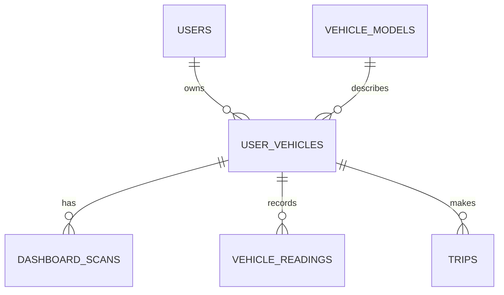

# ZERO FEAR – Database Design

## 1. Overview

ZERO FEAR will use PostgreSQL with PostGIS. Django ORM will manage database operations.

The initial database design focuses on users, vehicle models, registered vehicles, dashboard scans, confirmed vehicle readings and trips.

## 2. Initial Entities

### Users

Stores account information. Use a custom Django user model.

Proposed fields:

- id (UUID primary key)
- email (unique)
- password (Django-managed password hash)
- first_name
- last_name
- created_at
- updated_at

### Vehicle Models

Stores supported EV manufacturer and model information.

Proposed fields:

- id (UUID primary key)
- manufacturer
- model
- variant
- year
- battery_capacity_kwh (nullable)
- official_range_km (nullable)

### User Vehicles

Stores vehicles registered by users.

Proposed fields:

- id (UUID primary key)
- user_id (foreign key to Users)
- vehicle_model_id (foreign key to Vehicle Models)
- registration_number (optional)
- is_primary
- created_at
- updated_at

### Dashboard Scans

Stores dashboard scanning attempts and AI extraction results.

Proposed fields:

- id (UUID primary key)
- user_vehicle_id (foreign key to User Vehicles)
- image_reference
- extracted_data (JSON)
- status
- created_at
- confirmed_at (nullable)

Possible statuses:

- pending
- pending_review
- confirmed
- failed

### Vehicle Readings

Stores confirmed dashboard readings.

Proposed fields:

- id (UUID primary key)
- user_vehicle_id (foreign key to User Vehicles)
- battery_percentage
- displayed_range_km (nullable)
- odometer_km (nullable)
- source (AI or Manual)
- recorded_at
- created_at

Only confirmed readings should be used in normal reading history and insights.

### Trips

Stores user trip records.

Proposed fields:

- id (UUID primary key)
- user_vehicle_id (foreign key to User Vehicles)
- start_location
- destination
- distance_km (nullable)
- start_battery_percentage (nullable)
- end_battery_percentage (nullable)
- started_at (nullable)
- completed_at (nullable)
- created_at

Trip location fields may be refined into structured coordinates or PostGIS fields when routing functionality is implemented.

## 3. Entity Relationships

## 4. Relationship Explanation

- One user can register multiple vehicles.
- One vehicle model can be associated with multiple user vehicles.
- One registered vehicle can have multiple dashboard scans.
- One registered vehicle can have multiple confirmed readings.
- One registered vehicle can have multiple trips.

## 5. Future Entities

These can be introduced when the corresponding features are implemented.

### Charging Stations

Station name, location, operator, connector types, charging power and other available details.

### Charging Sessions

User vehicle, station, start and end times, energy delivered, cost and session status.

### Marketplace Listings

Seller, vehicle details, price, description, listing status and images.

### Favourites

User and favourited marketplace listing.

## 6. Design Principles

- Use UUID primary keys where appropriate.
- Use foreign keys to enforce relationships.
- Use database constraints for valid values.
- Add indexes for commonly queried fields.
- Store timestamps in UTC and display them in the user's local timezone.
- Use JSON for flexible AI extraction results, not as a replacement for core relational fields.
- Protect user-specific records with backend ownership checks.
- Keep unconfirmed scan results separate from confirmed readings.

## 7. Important Validation

Battery percentage must be between 0 and 100.

Distances and odometer readings must not be negative.

Optional values should remain null when they are not visible or available rather than being guessed.

## 8. Summary

The initial schema supports account management, EV registration, dashboard scanning, confirmed readings and basic trip history.

Charging, marketplace and advanced analytics entities can be added incrementally.
