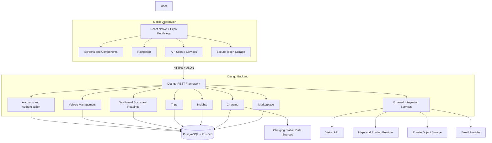

# ZERO FEAR – System Architecture

## 1. Overview

The React Native mobile application communicates with a Django REST Framework backend through HTTPS REST APIs.

The backend validates requests, applies business logic and accesses PostgreSQL. The mobile application does not connect directly to the database.

External services, including AI vision and maps, are accessed through backend integrations where practical so that private credentials remain on the server.

## 2. High-Level Architecture

## 3. Main Components

### Mobile Application

- React Native, Expo and TypeScript.
- Displays application screens and navigation.
- Captures dashboard images.
- Sends API requests and displays backend responses.
- Stores authentication tokens using secure device storage.

### Backend

- Python, Django and Django REST Framework.
- Handles authentication and authorization.
- Validates incoming requests.
- Implements vehicle, reading, trip and other application logic.
- Communicates with external providers.

### Database

- PostgreSQL stores users, vehicle catalogue records, registered vehicles, scans, confirmed readings and trips.
- PostGIS supports future location-based queries.

### External Services

- Vision API for dashboard image recognition.
- Maps and routing provider for map and journey functionality.
- Private object storage for uploaded images.
- Charging data sources for station information.
- Email provider for verification and password recovery.

## 4. Core Data Flow

1. The user performs an action in the mobile application.
2. The mobile application sends an HTTPS request to Django.
3. Django authenticates the request and checks permissions.
4. Django validates input and applies business rules.
5. Django reads or writes PostgreSQL data and, when required, calls an external service.
6. Django returns a JSON response.
7. The mobile application updates the interface.

## 5. Architecture Principles

- The mobile application must not access PostgreSQL directly.
- Private API keys must not be embedded in the mobile application.
- Backend authorization must enforce resource ownership.
- AI-extracted readings remain unconfirmed until the user approves them.
- External integrations should be isolated behind backend service modules.
- Initial development should prioritize the core MVP modules.
